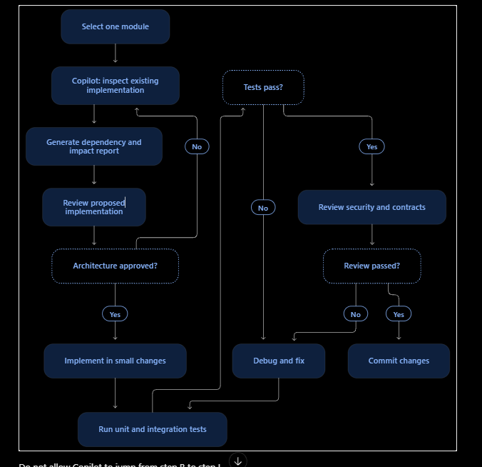

# ASCENSE - PROJECT ENGINEERING INSTRUCTIONS

## 1. Project Identity

Ascense is a multi-tenant, AI-assisted Security
Operations Platform (SOC SaaS).

It provides:
- Security telemetry ingestion
- Event normalization
- Event storage and aggregation
- Rule-based and ML-based detection
- Alert correlation
- Incident management
- AI-assisted investigation
- Response proposal generation
- Deterministic policy evaluation
- Human approval
- Signed command generation
- Customer-side gateway execution
- Independent execution verification

## 2. Primary Engineering Rule

NEVER assume that a module is missing.

Inspect the repository before creating, replacing,
or modifying any module.

Preserve working existing implementations.

Do not duplicate existing services, routes,
database models, or processing pipelines.

## 3. Architecture

Maintain separation between:

- API layer
- Authentication and authorization
- Domain services
- Data access layer
- Background workers
- Message broker
- Cache
- Detection engines
- AI investigation
- Response orchestration
- Customer-side gateway
- Observability

Do not put business logic directly inside API routes.

## 4. Execution Pipeline

Maintain this logical pipeline:

Sensors
-> Ingestion
-> Queue
-> Normalization
-> Storage
-> Detection
-> Correlation
-> Investigation
-> Proposal
-> Policy
-> Approval
-> Command
-> Gateway
-> Execution
-> Verification

Every stage must have explicit contracts.

Never bypass an existing stage.

## 5. Identifier Contracts

Use consistent identifiers:

tenant_id
user_id
sensor_id
gateway_id
asset_id
event_id
alert_id
incident_id
investigation_id
proposal_id
approval_id
command_id
execution_id
evidence_id
correlation_id
request_id
idempotency_key

Never invent inconsistent identifiers.

## 6. Multi-Tenant Security

- Enforce tenant isolation at every API boundary.
- Validate resource ownership.
- Use least-privilege access.
- Never trust tenant_id supplied by the client
  without validating authenticated context.
- Do not expose secrets in logs.
- Enforce authorization in the backend.

## 7. Reliability

- Use idempotent processing.
- Use bounded retries.
- Implement explicit timeout handling.
- Avoid unbounded queues and concurrency.
- Implement dead-letter handling.
- Preserve event identity.
- Handle duplicate delivery.
- Never assume a timeout means execution failed.

## 8. AI Safety

- AI can investigate and recommend.
- AI cannot independently authorize execution.
- AI output must be schema-validated.
- Evidence must be traceable.
- Treat external logs as untrusted input.
- Restrict agent tools.
- Enforce token and cost budgets.

## 9. Response Safety

- Use approved action templates.
- Validate proposals independently.
- Bind approvals to immutable proposal versions.
- Sign commands.
- Verify commands at the gateway.
- Maintain a durable execution journal.
- Implement rollback where supported.
- Independently verify actual execution state.

## 10. Development Rules

Before changing a module:

1. Inspect existing implementation.
2. Identify dependencies.
3. Identify API contracts.
4. Identify database dependencies.
5. Identify tests.
6. Explain the proposed changes.

After changing a module:

1. Run relevant tests.
2. Run linting and type checks.
3. Check backward compatibility.
4. Check tenant isolation.
5. Check execution flow.
6. Report changed files.
7. Report remaining limitations.

## 11. Copilot Restrictions

Do not:
- Rewrite the entire application.
- Create duplicate modules.
- Change API contracts without approval.
- Change database schemas without migrations.
- Invent successful execution states.
- Use mock data in production paths.
- Disable tests to make builds pass.
- Remove security validations.
- Introduce unnecessary dependencies.

## 12. Implementation Philosophy

Correctness first.
Security second.
Reliability third.
Performance fourth.
Convenience fifth.

All architectural decisions must be documented.
